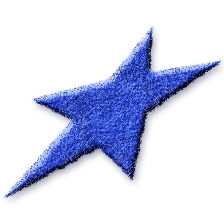
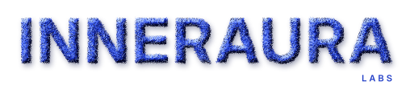
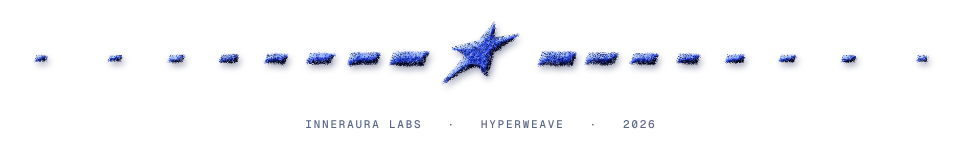

## InnerAura

*Visual Infrastructure for Agents*

 

Our research focuses on **agentic systems** and **generative tools** that enhance rather than automate, augment rather than substitute. We believe the most profound breakthroughs emerge when artificial intelligence serves to unlock human potential, deepen understanding, and amplify creative expression.

**Core Research Areas:**
- **Amplifying Creativity** - AI partners that spark innovation and creative breakthroughs
- **Deepening Understanding** - Systems that expand insight and knowledge discovery
- **Unlocking Potential** - Tools that reveal and develop latent human capabilities

**Our Approach:**

We're developing foundational tools and frameworks that enable developers to create more resonant and effective AI experiences.

<!--
### Our Flagship Product: HyperWeave

HyperWeave is the first implementation of our vision. It's a platform that automates the creation of beautiful, unique, and intelligent UI components from creative constraints. It's the engine for ending visual homogenization and the first step towards a truly intelligent visual web.

**[Explore HyperWeave →](https://github.com/InnerAura/hyperweave)**
-->

**Let's Build Together:**

We're building the future of human-AI collaboration, and our first step is **HyperWeave**. Explore the project, try our demos, and help us build the tools that will power the next generation of visual intelligence.

Join the `InnerAura` community to contribute to the vision. Whether you're a developer, researcher, or artist, we welcome your ideas. Cheers!

 

<picture>
  <source media="(prefers-color-scheme: dark)" srcset="https://raw.githubusercontent.com/InnerAura/.github/main/assets/footers/inneraura_felt_footer.svg">
  <source media="(prefers-color-scheme: light)" srcset="https://raw.githubusercontent.com/InnerAura/.github/main/assets/footers/inneraura_felt_footer.svg">
  
</picture>

<!-- FOOTER: SOCIAL RIBBONS -->

<picture>
  <source media="(prefers-color-scheme: dark)" srcset="https://raw.githubusercontent.com/InnerAura/.github/main/assets/dividers/inneraura_felt_divider.dark.svg">
  <source media="(prefers-color-scheme: light)" srcset="https://raw.githubusercontent.com/InnerAura/.github/main/assets/dividers/inneraura_felt_divider.light.svg">
  
</picture>

<!-- GITHUB README VERSION — single image + image map (aligned rows, full-card hitboxes)

<map name="social-links">
  <area shape="rect" coords="40,50,400,114" href="https://discord.gg/wVmcAZPQZ8" alt="Discord" />
  <area shape="rect" coords="500,50,860,114" href="https://x.com/InnerAuraLabs" alt="X" />
  <area shape="rect" coords="40,196,400,260" href="https://github.com/InnerAura/hyperweave" alt="Try HyperWeave" />
  <area shape="rect" coords="500,196,860,260" href="https://github.com/InnerAura/hyperweave" alt="Docs & Guides" />
</map>
-->

<!-- REFERENCE LINKS -->
[hyperweave]: https://github.com/InnerAura/hyperweave
[discord]: https://discord.gg/wVmcAZPQZ8
[instagram]: https://www.instagram.com/hyperweave.ai/
[linkedin]: https://www.linkedin.com/company/inneraura
[tiktok]: https://www.tiktok.com/@hyperweave.ai
[x]: https://x.com/InnerAuraLabs
[youtube]: https://www.youtube.com/@InnerAuraLabs
>